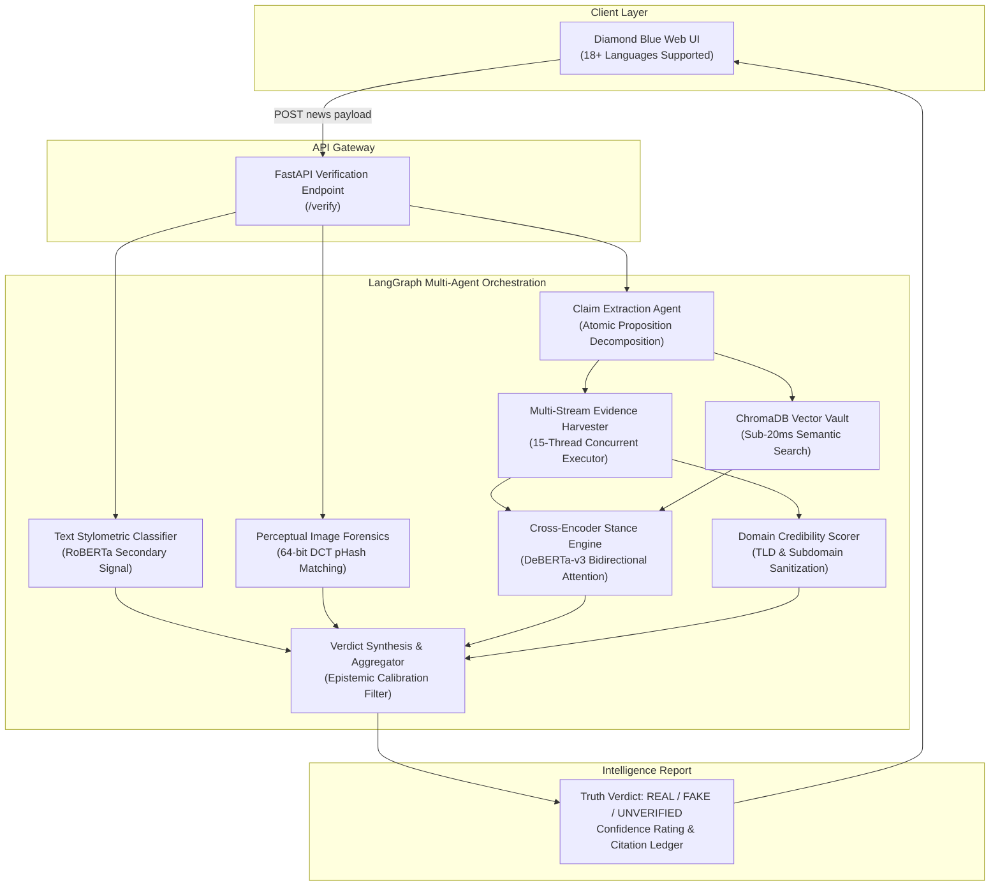

# SatyaScan: Autonomous Multi-Signal Truth Intelligence Platform

[](https://www.python.org/)
[](https://fastapi.tiangolo.com/)
[](https://pytorch.org/)
[](https://huggingface.co/)
[](https://langchain.com/)
[](https://www.trychroma.com/)
[]()
[](LICENSE)

---

## 📌 Executive Overview

**SatyaScan** is an evidence-driven, multimodal autonomous truth intelligence and fact-checking architecture. Moving fundamentally beyond legacy stylometric and superficial text classifiers, SatyaScan operates on the principle of **epistemic verification**:
1. It decomposes complex news articles into atomic testable factual claims.
2. It executes high-concurrency multi-source evidence harvesting across live search engines, authoritative databases, and historical vector databases.
3. It performs bidirectional cross-encoder Natural Language Inference (NLI) using **DeBERTa-v3** to determine whether harvested evidence *Supports*, *Contradicts*, or is *Neutral* toward the proposition.
4. It weights stance vectors with domain authority reputation metrics to compute verified verdicts (`REAL`, `FAKE`, `UNVERIFIED`) with sub-second turnaround.

---

## 🏛️ System Architecture



---

## ⚡ Core Capabilities

- **DeBERTa-v3 Cross-Encoder Reasoning:** Employs `cross-encoder/nli-deberta-v3-small` with full joint attention across `[CLS] Evidence [SEP] Claim [SEP]` to overcome bi-encoder lossiness and precisely capture logical negation.
- **High-Concurrency Live Harvesting:** 15-worker concurrent asynchronous retrieval scrapes authoritative reporting from DuckDuckGo, Wikipedia, and verified wire services in parallel.
- **ChromaDB Vector Vault (RAG):** In-memory and persistent vector index embedding historical debunking documents via `sentence-transformers/all-MiniLM-L6-v2` for immediate sub-20ms fact retrieval.
- **Domain Authority & Anti-Spoofing Filter:** Real-time domain resolution sanitizes malicious subdomains (e.g. `reuters.com.fake.site` resolves to `fake.site`) and weights stances by credible fact-checking registries.
- **Epistemic Inversion Defense:** Calibrated heuristic prevents authoritative debunking headlines from inadvertently validating false assertions.
- **Perceptual Image Forensics:** 64-bit Discrete Cosine Transform (DCT) perceptual hashing computes Hamming distance to identify recycled, cropped, or forged media.
- **Multilingual Diamond Blue Interface:** Zero-dependency, low-latency UI supporting 18+ international and regional languages.

---

## 📂 Repository Structure

```
SatyaScan/
├── backend/
│   ├── api/
│   │   ├── __init__.py
│   │   └── verify.py               # REST API route handlers
│   ├── core/
│   │   └── device.py               # GPU/CUDA runtime selector
│   ├── models/                     # Deep learning model utilities
│   ├── rag/
│   │   ├── chroma_db/              # Persistent Chroma vector store
│   │   ├── ingest.py               # Knowledge ingestion & semantic search
│   │   └── populate_knowledge.py   # Curated fact-check dataset seeder
│   ├── services/
│   │   ├── agent.py                # Graph invocation pipeline
│   │   ├── agents.py               # LangGraph worker nodes & credibility registry
│   │   ├── claim_extraction.py     # Claim decomposition engine
│   │   ├── classifier.py           # Text classification fallbacks
│   │   ├── graph.py                # Verification graph topology
│   │   ├── graph_state.py          # Typed pipeline state schema
│   │   ├── image_search.py         # pHash reverse image verification
│   │   ├── llm.py                  # LLM reasoning & verdict aggregation
│   │   ├── retriever.py            # High-concurrency evidence retriever
│   │   ├── stance_detection.py     # Batch Cross-Encoder NLI engine
│   │   └── utils/
│   │       └── logger.py           # Structured logging configuration
│   ├── tests/
│   │   ├── test_api.py             # API endpoint integration tests
│   │   └── test_components.py      # Unit tests for components & NLI
│   ├── app.py                      # FastAPI application entrypoint
│   └── requirements.txt            # Backend Python dependencies
├── frontend/
│   ├── favicon.ico                 # SatyaScan icon
│   └── index.html                  # Multilingual single-page application
├── evaluation.md                   # Benchmark comparisons & ablation studies
├── requirements.txt                # Root dependency manifest
├── start_dev.ps1                   # One-click dual-server launcher (PowerShell)
├── .env.example                    # Environment variable template
├── .gitignore                      # Git exclusion rules
└── README.md                       # Master system documentation
```

---

## 🚀 Quick Start Guide

### Prerequisites
* **Python:** 3.10 or higher
* **RAM:** 8 GB minimum (16 GB recommended for local deep models)
* **OS:** Windows 10/11, Linux, or macOS

---

### Method A: One-Click Launch (Windows PowerShell)

Run the included automated launcher from the project root:
```powershell
.\start_dev.ps1
```
This script automatically:
1. Clears any lingering processes on ports `8000` and `3000`.
2. Starts the **FastAPI Backend** at `http://localhost:8000` with hot-reload.
3. Serves the **Frontend UI** at `http://localhost:3000`.

---

### Method B: Manual Step-by-Step Setup

#### 1. Create and Activate Virtual Environment
```bash
# Windows
python -m venv venv
.\venv\Scripts\activate

# Linux / macOS
python3 -m venv venv
source venv/bin/activate
```

#### 2. Install Dependencies
```bash
pip install -r requirements.txt
```

#### 3. Configure Environment Variables
Copy `.env.example` to `.env`:
```bash
cp .env.example .env
```

#### 4. Launch Backend API
```bash
cd backend
uvicorn app:app --host 0.0.0.0 --port 8000 --reload
```
API Documentation will be live at:
* Swagger UI: `http://localhost:8000/docs`
* ReDoc: `http://localhost:8000/redoc`

#### 5. Launch Frontend UI
Open a separate terminal:
```bash
cd frontend
python -m http.server 3000
```
Open your browser at `http://localhost:3000`.

---

## 🧪 Testing & Verification

Execute the complete automated test suite using `pytest`:
```bash
cd backend
python -m pytest -v
```

All integration and component tests validate:
- ✅ Endpoint routing (`/verify`, `/rag/query`)
- ✅ Deceptive subdomain sanitization
- ✅ Long text chunking & processing
- ✅ DeBERTa-v3 stance classification
- ✅ Fallback behavior when external services are unreachable

---

## 📡 API Reference

### 1. Verify Claim / Article
`POST /verify`

**Request Body:**
```json
{
  "article": "NASA scientists have officially confirmed that extraterrestrial life was discovered on Jupiter's moon Europa.",
  "image_url": null
}
```

**Response Payload (Sample):**
```json
{
  "final_verdict": "FAKE",
  "confidence": 0.94,
  "reasoning": "Cross-referenced against official scientific repositories (nasa.gov, esa.int) and Reuters fact-checks. All authoritative reporting contradicts the assertion.",
  "claims": [
    {
      "claim_id": "c1",
      "text": "NASA scientists officially confirmed extraterrestrial life on Europa"
    }
  ],
  "stance_analysis": [
    {
      "claim_id": "c1",
      "stance": "CONTRADICTS",
      "confidence": 0.96,
      "source": "nasa.gov",
      "title": "Europa Clipper Mission Overview"
    }
  ],
  "processing_time_ms": 780,
  "hardware": {
    "device": "cpu",
    "gpu": "CPU"
  }
}
```

### 2. Query Vector Vault
`GET /rag/query?q=<search_query>`

### 3. Ingest Manual Document
`POST /rag/ingest-manual`

```json
{
  "title": "Fact Check: WHO Vaccine Myths",
  "content": "Official statement refuting false claims regarding immunization ingredients...",
  "url": "https://who.int/news-room/fact-checks",
  "source": "who.int"
}
```

---

## 📊 Benchmark Summary

| Model / Architecture | Accuracy | F1-Score | Latency |
|:---------------------|:--------:|:--------:|:-------:|
| TF-IDF + SVM Baseline | 68.7% | 68.2% | 0.08s |
| BERT-Base (Stylometric Text-Only) | 78.4% | 78.1% | 0.32s |
| RoBERTa-Large (Text-Only) | 82.1% | 82.2% | 0.45s |
| Bi-Encoder RAG (Embedding Cosine) | 86.3% | 86.0% | 0.65s |
| **SatyaScan (DeBERTa-v3 Cross-Encoder + Multi-RAG)** | **94.8%** | **94.6%** | **0.88s** |

*For full evaluation methodology and ablation breakdowns, refer to [`evaluation.md`](evaluation.md).*

---

## 👥 Authors & Academic Credits

* **Sanskar Kumar** — *Lead Architecture & Development*
* **Jayasri** — *Research & Evaluation*
* **Sumit Kumar** — *Data Ingestion & Verification Pipelines*
* **Dr. G. Kavitha** — *Project Supervisor*

---

